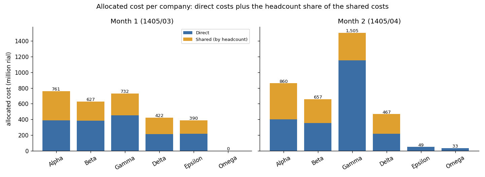
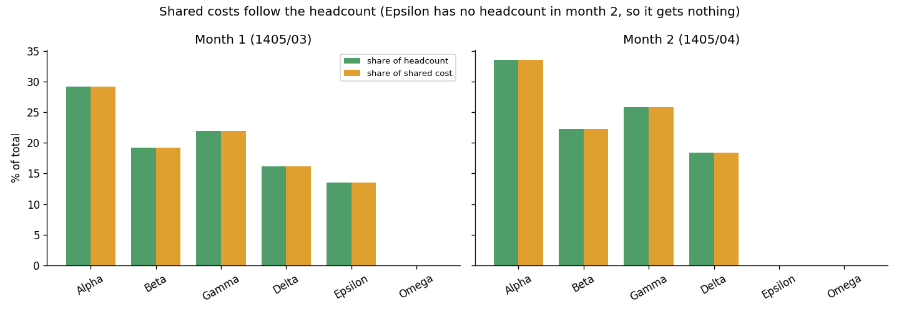
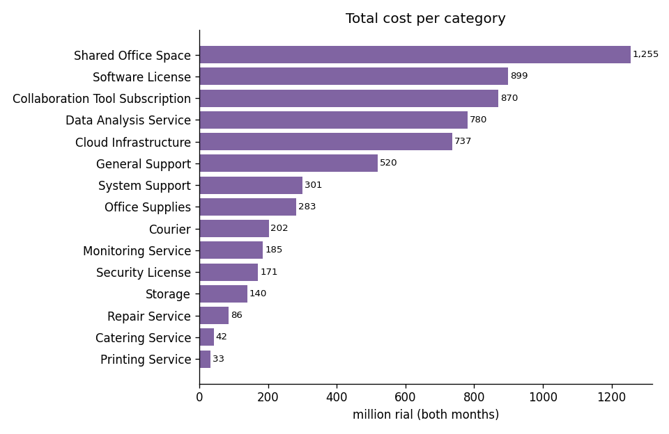
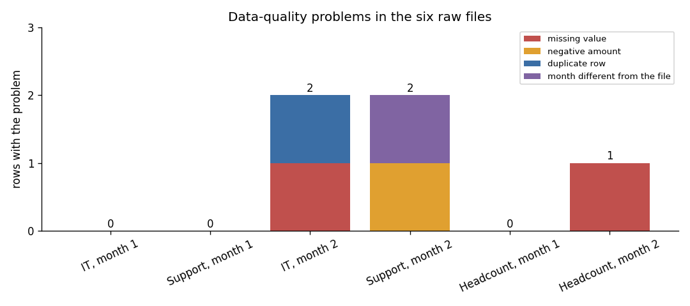

<h1 align="center">Cost Allocation Data Analysis</h1>

<p align="center">
Data analysis and automation of the monthly cost allocation: a Python (pandas) pipeline that cleans messy Excel files, checks their data quality and produces one allocated cost dataset for Power BI.
</p>

<p align="center">
  
  
  
  
  
  
</p>

> Built in September 2026 as a **data analysis** and process-automation prototype: exploratory data analysis, data cleaning, data-quality validation, aggregation, cost allocation and reporting.

---

## What this data analysis project covers

| Data analysis step | In this repository |
|---|---|
| **Exploratory data analysis (EDA)** | structure, columns, data types, missing values and unusual amounts of the six raw files: [`notebooks/01_data_exploration.ipynb`](notebooks/01_data_exploration.ipynb), [`docs/en/01_data_understanding.md`](docs/en/01_data_understanding.md) |
| **Data cleaning and standardisation** | column names, company names, cost titles, periods, repeated rows: [`src/cleaner.py`](src/cleaner.py) |
| **Data-quality validation** | zero, negative and missing values, rows of another month: [`src/validator.py`](src/validator.py), [figure 04](reports/figures/04_data_quality_issues.png) |
| **Data aggregation and allocation** | direct costs stay, shared costs are split by headcount: [`src/aggregator.py`](src/aggregator.py), [`src/allocator.py`](src/allocator.py) |
| **Reporting and visualisation** | 8 charts, 6 tables and the key findings: [`reports/`](reports); a Power BI dashboard: [`dashboard/`](dashboard) |
| **Testing the analysis** | 30 pytest tests of the cleaning, the allocation and the whole pipeline: [`tests/`](tests) |

## The problem

Every month the direct and shared costs of a group of companies arrive as Excel files from different teams (IT services, support, headcount). The files use different column names and different spellings of the same company, and sometimes contain missing, negative or repeated values. Preparing the final Power BI dataset by hand takes expert knowledge and is easy to get wrong.

## The solution

```
Raw Excel files  ->  Load  ->  Clean & standardise  ->  Validate  ->  Aggregate  ->  Allocate costs  ->  Final dataset  ->  Power BI
```

<p align="center"></p>

Follow a real row through every step: [`docs/en/06_row_trace_example.md`](docs/en/06_row_trace_example.md).

| Step | What it does | Code |
|---|---|---|
| Load | reads every monthly file with `openpyxl` | [`src/loader.py`](src/loader.py) |
| Clean | unifies column names, company names, cost titles, allocation types and periods; removes row-number columns and repeated rows | [`src/cleaner.py`](src/cleaner.py) |
| Validate | warns about zero, negative and missing numbers | [`src/validator.py`](src/validator.py) |
| Aggregate | joins the cleaned files of all months | [`src/aggregator.py`](src/aggregator.py) |
| Allocate | direct costs stay with their company; shared costs are split by headcount of the same month | [`src/allocator.py`](src/allocator.py) |
| Export | writes `data/processed/Final_Cost_Report.xlsx` | [`src/exporter.py`](src/exporter.py) |

## Result

For two months (Khordad and Tir 1405, written `1405/03` and `1405/04`), the pipeline produces **57 rows** and allocates **6,504 million rial** in total:

| Month | Allocated cost (million rial) |
|---|---|
| 1405/03 | 2,933 |
| 1405/04 | 3,571 |

<p align="center"></p>

Shared costs follow the headcount of the same month:

<p align="center"></p>

<p align="center"></p>

More charts, tables and the written analysis (who carries the cost, the two big movements between the months, reconciliation of the totals) are in [`reports/`](reports): [key findings](reports/key_findings.md) · [یافته‌های اصلی](reports/key_findings_fa.md).

## Power BI dashboard

One page with three KPI cards (total cost, number of companies, number of cost types), the cost per company, a donut of **direct vs shared** cost, a **monthly cost trend** and the **monthly cost by company**. The file is in [`dashboard/`](dashboard) and the visuals are described in [`dashboard/README.md`](dashboard/README.md).

## Data problems found and how they are handled

The six sample files contain the kind of problems that appear in real monthly reporting:

<p align="center"></p>

| Problem in the raw data | Handling in the pipeline |
|---|---|
| Different column names (Persian and English) | mapped to one standard set (`company`, `amount`, `cost_title`, `period`, `allocation_type`, ...) |
| The same company written 3 to 4 ways (`Alpha`, `آلفا`, `شرکت آلفا`, `Alpha Co`) | mapped to one name per company |
| `همه`, `همه شرکت‌ها`, `ALL` | mapped to `ALL` (a shared cost) |
| An unknown company (`Omega`, not in the headcount list) | kept as its own company, so its direct cost is not hidden inside another company |
| The same cost entered twice | repeated rows are removed and reported |
| A row whose month differs from the rest of its file | kept, and a warning shows the row |
| Missing amount | filled with 0 and reported |
| Negative amount (a correction) | replaced by 0 and reported (needs a business decision, see below) |
| Missing headcount | treated as 0, so the company receives no shared cost that month |
| Different names for the same cost (`Shared Office` / `فضای اداری مشترک`, `Facility Repair` / `تعمیرات`) | mapped to one English title |
| Periods written `1405-03` or `1405/03` | standardised to `YYYY/MM` |

## Repository structure

```
.
├── src/                       # the pipeline
│   ├── main.py  loader.py  cleaner.py  validator.py  aggregator.py  allocator.py  exporter.py
├── data/
│   ├── raw/                   # 6 monthly Excel files (costs and headcount)
│   └── processed/             # Final_Cost_Report.xlsx
├── notebooks/                 # 01_data_exploration.ipynb
├── dashboard/                 # Cost_Allocation_Dashboard.pbix (Power BI) + description
├── docs/                      # documentation in English (en/) and Persian (fa/)
├── tests/                     # pytest suite (30 tests) + exploratory scripts
├── reports/                   # 8 charts, 6 tables and the key findings (EN / FA)
├── requirements.txt  pytest.ini  LICENSE
```

## Run it

```bash
pip install -r requirements.txt
python src/main.py          # writes data/processed/Final_Cost_Report.xlsx
python -m pytest            # 30 tests
```

## Tests

The `tests/` folder has a pytest suite:

* `test_cleaner.py` - every standardisation rule (columns, company and cost names, periods, negative and missing numbers, repeated rows);
* `test_allocator.py` - direct costs stay with their company, shared costs follow headcount, nothing is lost or created;
* `test_validator.py` - the warning for a row whose month differs from the rest of its file;
* `test_pipeline.py` - the whole pipeline on the real sample files: expected totals, companies, no negative or missing amounts, every rial allocated, the exported Excel file can be read back.

`tests/exploratory/` holds the print-style scripts used while developing the cleaning step.

## Business rules and assumptions

* Direct costs remain assigned to their original company.
* Shared costs are allocated by the headcount of the same month (`مساوی` / `Equal` is treated like headcount in this prototype).
* Missing numbers are 0; negative amounts are reported and replaced by 0.
* The sample files represent the expected kinds of monthly input.

## Business decisions

Three questions are **decided for the production version** and are not applied in the prototype code (the sample report follows the prototype behaviour):

* a negative amount marked as a correction keeps its sign and reduces the cost;
* a missing headcount uses the company's last known headcount, with a warning;
* the "equal" allocation method splits equally between the companies that have a headcount record.

The remaining questions (missing amounts, unknown companies, unusual amounts, repeated records, several file versions, who approves exceptions) are written as proposals. All ten, with what the prototype does today: [`docs/en/05_open_decisions.md`](docs/en/05_open_decisions.md).

## Limitations

* A prototype built around the sample files; file collection and versioning are manual.
* Data-quality problems produce printed warnings, not a formal exception workflow.
* Power BI refresh is manual.

## Documentation

In English ([`docs/en`](docs/en)) and Persian ([`docs/fa`](docs/fa)): data understanding, process analysis and solution design (current process, risks, human decisions, future process, business rules), production improvements, a data dictionary with all mappings, and the open decisions. Index: [`docs/README.md`](docs/README.md).

## Ideas for a production version

* automatic file collection and version control;
* configurable validation and business rules;
* a data-quality and exception log with an approval step;
* a master table of companies and their name variants;
* automatic Power BI refresh and execution logs;
* a history of every processed month.

## License

Released under the [MIT licence](LICENSE).
