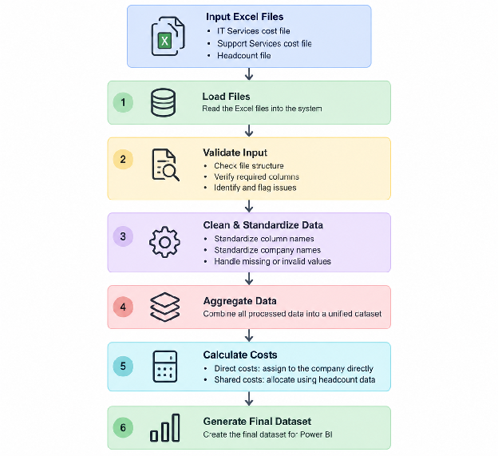

# ۰۲ - تحلیل فرایند و طراحی راه‌حل

فرایند ماهانه‌ی تخصیص هزینه امروز چگونه انجام می‌شود، کجا مشکل دارد، چه بخش‌هایی را می‌شود خودکار کرد و پروتوتایپ چگونه طراحی شده است.

## ۱. فرایند فعلی

| مرحله | فعالیت | مسئول | ورودی | خروجی |
|---|---|---|---|---|
| ارسال فایل‌ها | فایل‌های Excel توسط واحدها ارسال می‌شود | افراد واحدهای مختلف | - | فایل‌های Excel واحدها |
| جمع‌آوری فایل‌ها | فایل‌ها روز پنجم ماه دریافت و ارسال‌نشده‌ها پیگیری می‌شوند | کارشناس | فایل‌های Excel واحدها | فایل‌های Excel واحدها |
| بررسی فایل‌ها | ساختار فایل، کامل‌بودن، مربوط‌بودن به ماه درست و آخرین نسخه‌بودن بررسی می‌شود | کارشناس | فایل‌های Excel واحدها | در صورت مشکل جدی به واحد برگردانده می‌شود؛ در غیر این صورت فایل‌ها ادامه می‌دهند |
| اصلاح و پاک‌سازی داده | نام‌های متفاوت شرکت، مقدار خالی و عدد عجیب اصلاح می‌شود | کارشناس | فایل‌های Excel واحدها | فایل‌های اصلاح‌شده |
| تجمیع داده‌ها | اطلاعات همه‌ی فایل‌ها وارد فایل اصلی می‌شود | کارشناس | فایل‌های اصلاح‌شده | فایل اصلی |
| محاسبه‌ی هزینه‌ها | هزینه‌های مشترک با فایل تعداد نفرات محاسبه می‌شود | کارشناس منابع انسانی | فایل اصلی + فایل تعداد نفرات از منابع انسانی | فایل اصلی دارای هزینه‌ی مستقیم و مشترک |
| کنترل نهایی | درست‌بودن مجموع هزینه‌ها و مشکل‌های احتمالی بررسی می‌شود | کارشناس | فایل اصلی دارای هزینه‌ی مستقیم و مشترک | فایل اصلی کنترل‌شده و بدون اشکال |
| تأیید مدیر | موارد غیرعادی بررسی می‌شود | مدیر | فایل اصلی کنترل‌شده | فایل نهایی تأییدشده توسط مدیر |
| آماده‌سازی BI | داده آماده و داده‌ی Power BI رفرش می‌شود | کارشناس | فایل نهایی تأییدشده | داشبورد Power BI |

## ۲. مشکل‌ها و ریسک‌ها

| مرحله‌ی فرایند | مشکل | ریسک | اثر |
|---|---|---|---|
| جمع‌آوری فایل‌ها | پیگیری دریافت فایل‌ها دستی انجام می‌شود | فراموش‌شدن پیگیری | تأخیر در شروع محاسبات |
| بررسی فایل‌ها | ساختار فایل‌های ارسالی یکسان نیست و این بررسی طول می‌کشد | بررسی دستی، اتلاف انرژی و وقت | افزایش زمان آماده‌سازی داده |
| اصلاح و پاک‌سازی داده | اصلاح فایل‌ها دستی است | خطای انسانی و زمان زیاد | نادرست‌بودن فایل نهایی و افزایش زمان آماده‌سازی |
| تجمیع داده‌ها | تجمیع داده‌ها دستی انجام می‌شود | خطای انسانی | نادرست‌بودن فایل نهایی و افزایش زمان آماده‌سازی |
| محاسبه‌ی هزینه‌ها | منطق تخصیص هزینه‌ی مشترک در تجربه‌ی کارشناس است | اگر کارشناس در دسترس نباشد محاسبه دچار مشکل می‌شود | وابستگی به یک فرد و افزایش زمان برای نیروی جدید |
| کنترل نهایی | کنترل نهایی دستی توسط کارشناس انجام می‌شود | خطای انسانی | زمان و انرژی زیادی از کارشناس می‌گیرد |

## ۳. کجا تصمیم انسانی لازم است و چرا؟

| مرحله | تصمیم انسانی | دلیل نیاز به انسان |
|---|---|---|
| جمع‌آوری فایل‌ها | پیگیری واحدهایی که فایل نفرستاده‌اند | پیگیری از واحدها به انسان نیاز دارد |
| بررسی فایل‌ها | تشخیص اینکه مشکل فایل قابل اصلاح است یا باید برگردانده شود | شدت مشکل و اینکه قابل حل یا قابل قبول است، قضاوت انسان می‌خواهد |
| اصلاح و پاک‌سازی داده | تشخیص اینکه یک مقدار غیرعادی خطاست یا داده‌ی واقعی | سیستم نباید مقداری را حدس بزند؛ انسان باید درستی آن را تأیید کند |
| تأیید مدیر | تأیید نهایی | تصمیم نهایی مالی و مدیریتی به انسان نیاز دارد |

## ۴. سؤال‌های کسب‌وکار که باید پاسخ داده شوند

| حوزه | سؤال | دلیل اهمیت |
|---|---|---|
| قالب فایل نهایی | قالب فایل نهایی دقیقاً چگونه است؟ | برای خودکارسازی باید قالب فایل نهایی را بدانیم |
| نام شرکت‌ها | فهرست رسمی نام شرکت‌ها، نام‌های مشابه و مقدار استاندارد چیست؟ | برای ساخت نگاشت (mapping) نام شرکت‌ها |
| کنترل نسخه | اگر یک واحد چند نسخه بفرستد، معیار انتخاب نسخه چیست؟ (تاریخ ارسال، یا تأیید واحد که انسان می‌خواهد) | برای جلوگیری از پردازش نسخه‌ی اشتباه |
| اصلاح داده | مبلغ غیرعادی بر چه اساسی تعریف می‌شود؟ محدوده‌اش چقدر است؟ | برای اینکه بدانیم یک مبلغ کی برای بررسی انسان کنار گذاشته شود |
| اصلاح داده | روش تخصیص «مساوی» با نوع مشترک فرق دارد؟ (فعلاً همان مشترک در نظر گرفته شده) | برای محاسبه‌ی هزینه‌ی شرکت‌ها مهم است |

## ۵. فرایند آینده

| مرحله | فعالیت پیشنهادی | نوع انجام | توضیح |
|---|---|---|---|
| جمع‌آوری فایل‌ها | کارشناس دستی پیگیری می‌کند که فایل‌ها ارسال شده یا نه | انسان | |
| بررسی فایل‌ها | بررسی ساختار، کامل‌بودن، ماه درست و آخرین نسخه؛ مقدار خالی، منفی یا غیرعادی را هم سیستم مدیریت می‌کند | ابتدا خودکار، بعد انسان | ستون‌ها باید همان و درست باشند؛ در پایان انسان تأیید می‌کند مشکل جدی نیست |
| اصلاح و پاک‌سازی داده | اگر نام شرکت یا نام ستون اشتباه باشد، نگاشت آن را اصلاح می‌کند | ابتدا خودکار، بعد انسان | ابتدا سیستم کار را انجام می‌دهد؛ در پایان انسان نام ستون‌های اشتباه را بررسی و مقدار خالی‌هایی را که سیستم هشدار داده رسیدگی می‌کند |
| تجمیع داده‌ها | سیستم خروجی فایل‌های Excel را به قالب فایل نهایی منتقل می‌کند | خودکار | |
| محاسبه‌ی هزینه‌ها | هزینه‌های مستقیم جمع می‌شوند؛ هزینه‌های مشترک با فایل تعداد نفرات تقسیم می‌شوند و رقم نهایی به دست می‌آید | خودکار | |
| کنترل نهایی | انسان کنترل نهایی را انجام می‌دهد | انسان | چون مبلغ‌های غیرعادی و شرکت ناشناخته در مرحله‌های قبل توسط سیستم و انسان بررسی شده، این مرحله معمولاً زمان زیادی نمی‌گیرد؛ فقط یک بررسی نهایی پیش از ارسال برای مدیر است |
| تأیید مدیر | بررسی نهایی توسط مدیر | انسان | |
| دیتاست نهایی BI | دیتاست آماده‌ی BI | خودکار | |

**مواردی که خودکار می‌شوند:** خواندن و بررسی اولیه‌ی فایل‌ها؛ اصلاح و اعتبارسنجی داده؛ استانداردسازی ساختار؛ پاک‌سازی اولیه؛ تجمیع داده‌ها؛ محاسبه‌ی تخصیص هزینه‌ها؛ تولید دیتاست نهایی برای داشبورد.

**مواردی که برای انسان می‌ماند:** تأیید نام شرکت‌ها؛ تصمیم درباره‌ی داده‌های غیرعادی؛ تأیید مدیر.

## ۶. دامنه‌ی پروتوتایپ

| بخش فرایند | در پروتوتایپ پیاده‌سازی می‌شود؟ | توضیح |
|---|---|---|
| دریافت و خواندن فایل‌ها | بله | خواندن فایل‌های نمونه‌ی ورودی |
| بررسی فایل‌ها | بله | بررسی ساختار؛ مقدار خالی، منفی یا غیرعادی را هم سیستم مدیریت می‌کند |
| اصلاح و پاک‌سازی داده | بله | نگاشت نام‌های اشتباه شرکت و نام ستون‌ها |
| تجمیع داده‌ها | بله | انتقال داده‌ی Excel به قالب فایل نهایی |
| محاسبه‌ی هزینه‌ها | بله | |
| کنترل نهایی | خیر | |
| تأیید مدیر | خیر | |
| دیتاست نهایی BI | بله | خروجی قابل استفاده برای BI |

## ۷. جریان خط لوله



۱. **خواندن فایل‌ها** - ورودی: فایل‌های نمونه (خدمات فناوری، پشتیبانی، تعداد نفرات)؛ فایل‌های Excel خوانده می‌شوند؛ خروجی: دیتافریم‌های اولیه.
۲. **بررسی فایل‌ها** - اعتبارسنجی ورودی: آیا ساختار درست است؟ آیا ستون‌های لازم وجود دارند؟ آیا مقدار مشکل‌دار هست (مقدار خالی، مبلغ منفی یا غیرعادی)؟ خروجی: داده‌ی معتبر + هشدار برای بخش‌های مشکل‌دار.
۳. **اصلاح و پاک‌سازی داده** - پاک‌سازی و تبدیل: استانداردسازی نام ستون‌ها و نام شرکت‌ها؛ خروجی: داده‌ی آماده‌ی پردازش.
۴. **تجمیع داده‌ها** - داده‌های پردازش‌شده در یک دیتاست جمع می‌شوند.
۵. **محاسبه‌ی هزینه‌ها** - هزینه‌ی مستقیم مستقیماً جمع می‌شود؛ برای هزینه‌ی مشترک از فایل تعداد نفرات استفاده می‌شود؛ خروجی: هزینه‌ی تخصیص‌یافته به هر شرکت.
۶. **تولید دیتاست نهایی برای BI** - ساخت خروجی نهایی که بعداً وارد Power BI می‌شود.

## ۸. ورودی و خروجی

**ورودی** - فایل‌های Excel: فایل‌های هزینه‌ی خدمات فناوری، فایل‌های هزینه‌ی پشتیبانی و فایل تعداد نفرات (Headcount). این فایل‌ها اطلاعات هزینه و اطلاعات لازم برای تخصیص هزینه‌های مشترک را دارند.

**خروجی** - یک دیتاست نهایی برای گزارش‌گیری و Power BI با این اطلاعات: شرکت، دوره، نوع هزینه، مبلغ تخصیص‌یافته و نوع تخصیص (مستقیم / مشترک).

## ۹. قوانین کسب‌وکار

**قانون ۱ - تخصیص هزینه‌ی مستقیم.** اگر `Allocation Type = Direct` باشد، هزینه برای همان شرکت می‌ماند: `Allocated Company = Original Company` و `Allocated Amount = Original Amount`.
*مثال:* ورودی `Company: Alpha، Amount: 1,000,000، Type: Direct` خروجی `Company: Alpha، Allocated Amount: 1,000,000` می‌دهد.

**قانون ۲ - تخصیص هزینه‌ی مشترک.** اگر `Allocation Type = Shared` باشد، سیستم مجموع نفرات شرکت‌ها را پیدا می‌کند و هزینه را با این فرمول تقسیم می‌کند:
`Cost ÷ Total Headcount × Company Headcount`

**قانون ۳ - استانداردسازی نام شرکت.** نام‌هایی مثل `Alpha`، `آلفا` و `شرکت آلفا` به یک نام استاندارد نگاشت می‌شوند. این فقط یک سرویس نگاشت است و **سرویس هوشمند نیست**؛ بنابراین انسان باید بعد از این مرحله بررسی کند، چون ممکن است نامی هنوز اشتباه مانده باشد. در فازهای بعدی می‌شود یک سرویس هوش مصنوعی یا fuzzy اضافه کرد که دامنه‌ی بیشتری از اشتباه‌ها را تشخیص دهد و اصلاح کند.

**قانون ۴ - اعتبارسنجی داده.** در مرحله‌ی اصلاح و اعتبارسنجی، اگر مقدار خالی، مبلغ منفی یا شرکت ناشناخته وجود داشت، آنگاه `Status = Warning` می‌شود و بعد بررسی انسانی انجام می‌گیرد.

## ۱۰. ساختار کد

```
src/
├── main.py
├── loader.py
├── validator.py
├── cleaner.py
├── aggregator.py
├── allocator.py
└── exporter.py
```

| فایل | توضیح |
|---|---|
| `main.py` | اجرای خط لوله‌ی اصلی |
| `loader.py` | خواندن فایل‌های Excel ورودی |
| `validator.py` | بررسی ساختار و کیفیت داده |
| `cleaner.py` | استانداردسازی و پاک‌سازی داده‌ها |
| `aggregator.py` | تجمیع داده‌های پردازش‌شده |
| `allocator.py` | محاسبه و تخصیص هزینه‌ها |
| `exporter.py` | تولید دیتاست نهایی |

کد و خروجی‌های آن جای بهتر شدن دارد که در دامنه‌ی این تسک نبود.
