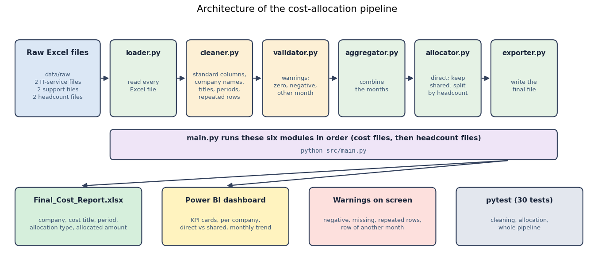

# ۰۶ - دنبال‌کردن یک ردیف از فایل خام تا گزارش نهایی

دو ردیف واقعی از داده‌ی نمونه، گام‌به‌گام. نشان می‌دهند هر ماژول خط لوله چه می‌کند.

## مثال ۱ - هزینه‌ی مشترک (`05_پشتیبانی_تیر_1405.xlsx`)

**ردیف خام**

| نام شرکت | عنوان هزینه | مبلغ | ماه | مبنای تسهیم | کد پیگیری | وضعیت |
|---|---|---|---|---|---|---|
| همه شرکت‌ها | فضای اداری مشترک | 645,000,000 | 1405/04 | تعداد نفرات | SUP-0406 | ثبت‌شده |

| گام | ماژول | چه بر سر ردیف می‌آید |
|---|---|---|
| ۱ | `loader.py` | شیت در یک جدول خوانده می‌شود |
| ۲ | `cleaner.py` | ستون‌ها نام استاندارد می‌گیرند (`company`، `cost_title`، `amount`، `period`، `allocation_type`، `reference`)؛ ستون وضعیت حذف می‌شود |
| ۳ | `cleaner.py` | `همه شرکت‌ها` به `ALL`، `فضای اداری مشترک` به `Shared Office Space` و `تعداد نفرات` به `Shared_Headcount` تبدیل می‌شود |
| ۴ | `validator.py` | چیزی برای گزارش نیست (مقدار صفر، منفی یا ماه دیگر ندارد) |
| ۵ | `aggregator.py` | ردیف به ردیف‌های هزینه‌ی فایل‌های دیگر می‌پیوندد |
| ۶ | `allocator.py` | هزینه با تعداد نفرات ماه `1405/04` (فایل `06_تعداد_نفرات_تیر_1405.xlsx`) تقسیم می‌شود |
| ۷ | `exporter.py` | پنج ردیف، یکی برای هر شرکت، در `Final_Cost_Report.xlsx` نوشته می‌شود |

**تقسیم.** تعداد نفرات `1405/04`: آلفا ۱۳۱، بتا ۸۷، گاما ۱۰۱، دلتا ۷۲، اپسیلون خالی (صفر حساب می‌شود)، جمع 391.
مبلغ تخصیص‌یافته = `645,000,000 × نفرات شرکت ÷ 391`:

| شرکت | تعداد نفرات | مبلغ تخصیص‌یافته (ریال) |
|---|---|---|
| Alpha | 131 | 216,099,744 |
| Beta | 87 | 143,516,624 |
| Gamma | 101 | 166,611,253 |
| Delta | 72 | 118,772,379 |
| Epsilon | 0 | 0 |
| **جمع** | 391 | **645,000,000** |

مجموع پنج ردیف برابر مبلغ اصلی است؛ پس چیزی گم یا اضافه نمی‌شود (`tests/test_pipeline.py` این را برای کل دیتاست بررسی می‌کند).

## مثال ۲ - اصلاحیه‌ی منفی (`05_پشتیبانی_تیر_1405.xlsx`)

**ردیف خام**

| نام شرکت | عنوان هزینه | مبلغ | ماه | مبنای تسهیم | کد پیگیری | وضعیت |
|---|---|---|---|---|---|---|
| شرکت گاما | تعمیرات | -12,000,000 | 1405/04 | مستقیم | SUP-0403 | اصلاحیه |

| گام | ماژول | چه بر سر ردیف می‌آید |
|---|---|---|
| ۱-۲ | `loader.py`، `cleaner.py` | خوانده می‌شود؛ ستون‌ها استاندارد می‌شوند؛ `شرکت گاما` به `Gamma company`، `تعمیرات` به `Repair Service` و `مستقیم` به `Direct` تبدیل می‌شود |
| ۳ | `validator.py`، `cleaner.py` | هشداری رکورد را نشان می‌دهد: *Negative values found in column 'amount'*؛ مبلغ صفر می‌شود |
| ۴ | `allocator.py` | هزینه‌ی مستقیم برای همان شرکت می‌ماند |

**ردیف نهایی:** `Gamma company | Repair Service | 1405/04 | Direct | SUP-0403 | 0`.

وضعیت `اصلاحیه` نشان می‌دهد این مبلغ منفی احتمالاً خطا نیست و اصلاحیه‌ای است که باید هزینه را **کم** کند؛ پروتوتایپ آن را صفر می‌کند و گزارش می‌دهد. برای نسخه‌ی عملیاتی تصمیم این است که علامت حفظ شود و هزینه کم شود ([۰۵](05_open_decisions.md))؛ پروتوتایپ هنوز این کار را نمی‌کند.
